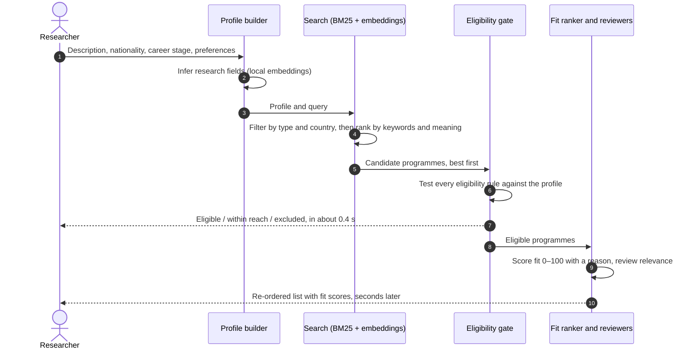
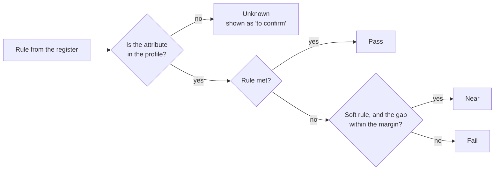
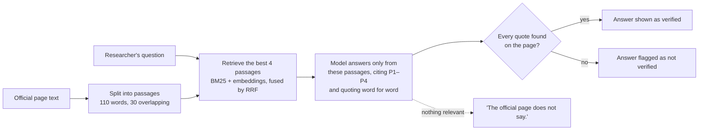

# How it works, explained

This page explains the methods inside ACCESS for readers from any background. Every section has three levels, and
you can stop at whichever suits you:

!!! abstract "In plain words"
    The idea in everyday language, with an analogy where one helps.

!!! example "Worked example"
    The method applied to a small, concrete case, with the actual numbers.

The **maths** sits between the two, with every symbol explained. All constants on this page are the values the
deployed system uses, and each section links to the layer page where the method is evaluated.

---

## The journey of one search

Before the individual methods, here is what happens between pressing **Find funding** and reading the results. The
first answer comes from local code alone; language models only refine it afterwards.

Swipe sideways to see the whole diagram.

The split matters for reliability: steps 1 to 7 involve no cloud service, so results appear even when every model
provider is unavailable. Steps 8 to 10 only re-order what the gate has already decided.

---

## 1 · Turning text into numbers: embeddings

!!! abstract "In plain words"
    A computer cannot compare the *meaning* of two sentences directly, so we convert each text into a list of
    numbers, called an **embedding**, in which texts with similar meanings receive similar numbers. Think of it as
    giving every text a position on a map with 768 directions instead of two: "PhD scholarship in machine learning"
    and "doctoral fellowship in artificial intelligence" land close together even though they share almost no words,
    while "grant for music performance" lands far away.

<svg viewBox="0 0 520 260" role="img" aria-label="Three text embeddings drawn as arrows; two related texts point in nearly the same direction, an unrelated one points elsewhere" style="width:100%;max-width:560px;height:auto">
  <line x1="40" y1="220" x2="500" y2="220" stroke="currentColor" stroke-opacity=".3"/>
  <line x1="40" y1="220" x2="40" y2="20" stroke="currentColor" stroke-opacity=".3"/>
  <line x1="40" y1="220" x2="400" y2="70" stroke="#2F6690" stroke-width="3"/>
  <circle cx="400" cy="70" r="5" fill="#2F6690"/>
  <text x="300" y="52" font-size="13" fill="currentColor">"PhD scholarship in machine learning"</text>
  <line x1="40" y1="220" x2="380" y2="105" stroke="#2F6690" stroke-width="3" stroke-opacity=".7"/>
  <circle cx="380" cy="105" r="5" fill="#2F6690" fill-opacity=".7"/>
  <text x="300" y="128" font-size="13" fill="currentColor">"doctoral fellowship in AI"</text>
  <line x1="40" y1="220" x2="120" y2="40" stroke="#C8642B" stroke-width="3"/>
  <circle cx="120" cy="40" r="5" fill="#C8642B"/>
  <text x="130" y="36" font-size="13" fill="currentColor">"grant for music performance"</text>
  <path d="M 125.2 191.1 A 90 90 0 0 0 123.1 185.4" fill="none" stroke="currentColor" stroke-width="2"/>
  <text x="150" y="207" font-size="12" fill="currentColor" fill-opacity=".85">small angle θ: similar meaning</text>
  <path d="M 81.5 202.7 A 45 45 0 0 0 58.3 178.9" fill="none" stroke="#C8642B" stroke-width="2"/>
  <text x="48" y="246" font-size="12" fill="#C8642B">orange arc, large angle: different meaning</text>
</svg>

**The maths.** We measure closeness by the angle between two embedding vectors $\mathbf{a}$ and $\mathbf{b}$, using
*cosine similarity*:

$$
\cos\theta \;=\; \frac{\mathbf{a}\cdot\mathbf{b}}{\lVert\mathbf{a}\rVert\,\lVert\mathbf{b}\rVert}
\;=\; \frac{\sum_{i=1}^{768} a_i b_i}{\sqrt{\sum_i a_i^2}\,\sqrt{\sum_i b_i^2}}
$$

The result runs from −1 (opposite) through 0 (unrelated) to 1 (same direction). We store every vector already
divided by its length, so at search time the similarity is a single dot product, $\mathbf{a}\cdot\mathbf{b}$, and
comparing a query with every programme in the library takes milliseconds.

!!! example "Worked example"
    With toy three-number embeddings $\mathbf{a} = (0.8, 0.6, 0)$ and $\mathbf{b} = (0.6, 0.8, 0)$, both of length 1:
    $\cos\theta = 0.8 \times 0.6 + 0.6 \times 0.8 + 0 = 0.96$, very similar. Against $\mathbf{c} = (0, 0, 1)$:
    $\cos\theta = 0$, unrelated.

**Where ACCESS uses it.** The model is `nomic-embed-text`, run locally, which produces 768 numbers per text.
Programme descriptions are embedded once when they are published; the researcher's query is embedded at search time.
See [Layer 2](layer2.md#research-matcher-hybrid-search).

---

## 2 · Keyword search: BM25

!!! abstract "In plain words"
    Embeddings are good at meaning but can blur exact names: "Chevening", "SINGA" or "cryo-EM" matter precisely.
    **BM25** is the classic keyword-scoring method behind many search engines. It rewards a programme for containing
    the words in your query, with three sensible adjustments: rare words count for more than common ones, repeating a
    word helps less and less, and long pages do not win merely by being long.

**The maths.** For a query $q$ and a programme description $d$:

$$
\text{BM25}(d, q) \;=\; \sum_{t \in q} \text{IDF}(t)\cdot
\frac{f(t,d)\,(k_1 + 1)}{f(t,d) + k_1\left(1 - b + b\,\dfrac{|d|}{\text{avgdl}}\right)}
$$

where the weight of a word, its *inverse document frequency*, is

$$
\text{IDF}(t) \;=\; \ln\!\left(1 + \frac{N - n(t) + 0.5}{n(t) + 0.5}\right)
$$

| Symbol | Meaning | Value in ACCESS |
|---|---|---|
| $f(t,d)$ | how many times word $t$ appears in description $d$ | counted |
| $\lvert d\rvert$, avgdl | length of $d$, and the average length across the library | counted |
| $N$, $n(t)$ | number of programmes, and how many contain $t$ | counted |
| $k_1$ | how quickly repeated words stop helping (saturation) | 1.5 |
| $b$ | how strongly long descriptions are penalised (0 = not at all, 1 = fully) | 0.75 |

!!! example "Worked example: the three adjustments"
    - **Rare words count more.** In a library of 1,000 programmes, a word found in 5 of them has
      $\text{IDF} = \ln(1 + 995.5/5.5) \approx 5.20$; a word found in 600 has $\text{IDF} \approx 0.51$. The rare
      word is worth about ten times as much.
    - **Repetition saturates.** For a description of average length, the word-count part of the formula is
      $f \cdot 2.5 / (f + 1.5)$: one mention gives 1.00, two give 1.43, five give 1.92, twenty give 2.33, and no
      number of repetitions can exceed 2.5.
    - **Length is normalised.** A description twice the average length needs more mentions to reach the same score.

**Where ACCESS uses it.** Matching programmes to a researcher (Layer 2), and finding the passages of an official page
that relate to a claim or a question (Layers 0 and 3). We implemented it directly from the formula above.

---

## 3 · Combining two rankings: reciprocal rank fusion

!!! abstract "In plain words"
    We now have two ranked lists, one by meaning and one by keywords, and their scores are on different scales: a
    cosine of 0.6 and a BM25 score of 14 cannot be added. **Reciprocal rank fusion (RRF)** ignores the raw scores and
    uses only each programme's *position* in each list. A programme near the top of either list scores well; one
    near the top of both scores best.

**The maths.** For each programme $d$, with $\text{rank}_r(d)$ its position in list $r$ (1 = top):

$$
\text{RRF}(d) \;=\; \sum_{r} \frac{w_r}{k + \text{rank}_r(d)}, \qquad k = 60,\quad
w_{\text{keyword}} = 2,\quad w_{\text{meaning}} = 1
$$

The constant $k = 60$ comes from the original paper [[18]](../references.md) and stops the very top positions from
dominating. The 2:1 weighting in favour of keywords was chosen on our known-item benchmark, where it found the target
programme in the top five for 93% of queries, against 88% for keywords alone and 73% for meaning alone.

!!! example "Worked example"
    | Programme | Rank by meaning | Rank by keywords | RRF score |
    |---|---|---|---|
    | A | 1 | 3 | $\frac{1}{61} + \frac{2}{63} = 0.04814$ |
    | **B** | 4 | **1** | $\frac{1}{64} + \frac{2}{61} = \mathbf{0.04841}$ |
    | C | 2 | 10 | $\frac{1}{62} + \frac{2}{70} = 0.04470$ |

    B finishes first: it is the strongest keyword match and still reasonable on meaning. C is close in meaning but
    shares few of the query's words, so it drops to third.

---

## 4 · Guessing research fields: zero-shot classification

!!! abstract "In plain words"
    The researcher writes a free-text description; the eligibility rules need fields such as "computer science" or
    "life sciences". Instead of training a classifier, we embed the description and the name of each of 24 fields,
    and keep the fields whose embeddings are closest. "Zero-shot" means no labelled training examples are needed.

**The maths.** With $s_j$ the cosine similarity between the description and field $j$, we keep every field within a
small margin of the best:

$$
\text{fields} \;=\; \{\, j \;:\; s_j \ge \max_i s_i - 0.035 \,\}, \quad \text{at most 4, best first}
$$

The margin exists because descriptions often span two areas. With only the single best field, one physicist's
description was labelled chemistry, because physics scored just below it; with the margin, both are kept. The researcher can always
confirm or change the fields. See [Layer 1](layer1.md#profile-builder).

---

## 5 · Eligibility as logic: the gate

!!! abstract "In plain words"
    Whether you *can* apply is a yes-or-no question with a reason, so we answer it with plain, tested code rather than
    a language model. Each programme's rules (nationality, career stage, years since PhD, language scores and so on)
    are stored as small typed statements, each with the quote it came from. The gate checks each rule against your
    profile, the same way every time.

Every rule is a triple, *attribute · operator · value*, for example `nationality in [Singapore, Singapore PR]` or
`ielts gte 6.5`. Checking one rule follows this decision path:

A programme's overall outcome then follows from its rules:

$$
\text{outcome} =
\begin{cases}
\text{excluded} & \text{if any rule fails}\\
\text{within reach} & \text{else if any rule is near}\\
\text{eligible} & \text{otherwise}
\end{cases}
$$

An *unknown* rule never counts as a pass: the result card marks it "to confirm", and the follow-up question
(section 6) asks for the missing fact.

**Near-miss margins.** Only soft rules can be near. Hard rules, such as nationality or age, either pass or fail.

| Soft rule | Counts as near if you are short by at most |
|---|---|
| IELTS | 1.0 band |
| TOEFL | 15 points |
| GPA | 0.3 |
| Publications | 2 |
| Work experience | 1 year |

**Ordering near misses.** Within-reach programmes are ordered by an estimated effort to close the gap, the *gap
cost*, in weeks:

$$
\text{gap cost} \;=\; \sum_{\text{near rules}} \frac{\text{required} - \text{yours}}{\text{step}} \times \text{weeks per step}
$$

with steps of 0.5 IELTS band (4 weeks), 5 TOEFL points (4 weeks), 0.1 GPA (8 weeks), one publication (12 weeks) and
one year of work experience (52 weeks). A missing career stage or degree counts as 26 weeks.

!!! example "Worked example"
    A programme asks for IELTS 7.0 and you have 6.5: the gap is 0.5, within the 1.0 margin, so the rule is *near*.
    Gap cost $= 0.5 / 0.5 \times 4 = 4$ weeks. A second programme asking for GPA 3.6 when you have 3.4 costs
    $0.2 / 0.1 \times 8 = 16$ weeks, so the IELTS programme is listed first.

The weeks are deliberately coarse; they are used only to put the easiest gaps first. See
[Layer 2](layer2.md#eligibility-gate).

---

## 6 · One follow-up question: greedy information gain

!!! abstract "In plain words"
    If many results say "to confirm: years since PhD", one answer settles all of them at once. ACCESS asks the
    single question that would settle the most open checks across your results, instead of a long questionnaire.

**The maths.** With $U(a)$ the number of *unknown* checks across the shown results that depend on attribute $a$:

$$
a^{*} \;=\; \arg\max_{a}\; U(a)
$$

Each unknown check is an uncertain outcome, so the attribute behind the most unknowns removes the most uncertainty
per question. This is a greedy, count-based approximation of *information gain*: it does not weigh how uncertain
each check is, which keeps it deterministic, instant and easy to explain.

---

## 7 · The fit score: late fusion

!!! abstract "In plain words"
    Once the gate has decided which programmes you can apply for, a language model reads each one alongside your
    profile and gives a fit score from 0 to 100 with a one-sentence reason. We blend that judgement with the
    meaning-based similarity from section 1, so the order reflects both a reasoned opinion and a measurable match.

**The maths.** First the cosine similarity is stretched onto 0–100, so that 0.3 becomes 0 and 0.8 becomes 100,
with values outside that range clipped:

$$
\text{sim}_{100} \;=\; \min\!\left(100,\; \max\!\left(0,\; \frac{\cos\theta - 0.3}{0.5} \times 100\right)\right)
$$

Then the two are combined:

$$
\text{score} \;=\; 0.7 \times \text{fit} \;+\; 0.3 \times \text{sim}_{100}
$$

!!! example "Worked example"
    The model gives a programme a fit of 90; its cosine similarity to the query is 0.62.
    $\text{sim}_{100} = (0.62 - 0.3)/0.5 \times 100 = 64$, so
    $\text{score} = 0.7 \times 90 + 0.3 \times 64 = 63 + 19.2 \approx 82$.

**Ordering rules.** Programmes the model scored come first, by score. A programme is listed under *weaker fit* if its
fit is below 40, or if two independent reviewers rate its relevance below 2 on a 1–5 scale on average. Programmes the
model did not score (for example when the free quota is exhausted) follow under their own heading, in similarity
order, because a similarity-only number is not on the same footing as a fit score.

The weights 0.7 and 0.3 are design choices, not learned from data: no outcome data existed to learn them from. The
ranker can only re-order; it can never add or remove a programme. See [Layer 3](layer3.md#fit-ranker).

---

## 8 · Verifying facts with a jury: majority voting

!!! abstract "In plain words"
    A single language model checking a fact can be wrong, and it can share blind spots with the model that extracted
    the fact. So every claim is put to a panel of three models from three different companies, none of them from the
    extractor's company, and a claim is shown only if a majority agrees it is on the page. A jury of independent
    people is more reliable than any one of them; the same holds for models, *provided* their mistakes are
    independent.

**The maths.** If each judge is right with probability $p$ and the judges err independently, a majority of three is
right with probability

$$
P(\text{majority correct}) \;=\; p^3 + 3p^2(1-p)
$$

(all three right, or exactly two right). This exceeds $p$ whenever $p > 0.5$, which is *Condorcet's jury theorem*.

!!! example "Worked example"
    Three judges, each 80% accurate and independent: $0.8^3 + 3 \times 0.8^2 \times 0.2 = 0.512 + 0.384 = 0.896$.
    The panel is right about 90% of the time, better than any single judge. If the three judges always made the
    *same* mistakes, the panel would be no better than one judge, which is why we use judges from different
    companies.

**The decision rule.** A claim is confirmed only if both conditions hold:

$$
\text{confirmed} \;=\; \underbrace{\text{located on the page}}_{\text{plain code}} \;\wedge\;
\underbrace{\text{at least 2 of 3 judges agree}}_{\text{language models}}
$$

The first condition is checked by code at no model cost: the claim's date, amount or quote must actually be found on
the page. A claim that fails either condition is not shown as fact; the card says "not stated, see the official page".

<strong>Locate</strong>Code searches the page for the claimed date, amount or quote.

<strong>Interpret</strong>Three judges from three companies read only that passage and vote.

<strong>Decide</strong>Located and a 2-of-3 majority: shown. Otherwise withheld.

See [Layer 0](layer0.md#3-info-critic).

---

## 9 · Measuring agreement: Fleiss' kappa

!!! abstract "In plain words"
    If three judges agree 90% of the time, is that impressive? Not if 90% of claims are obviously true, because they
    would agree that often by chance. **Fleiss' kappa** measures agreement *beyond* what chance alone would produce:
    1 is perfect agreement, 0 is no better than chance.

**The maths.** For $N$ items, each rated by $n$ judges into categories $j$, with $n_{ij}$ the number of judges who
put item $i$ in category $j$:

$$
\kappa \;=\; \frac{\bar{P} - \bar{P}_e}{1 - \bar{P}_e},\qquad
\bar{P} = \frac{1}{N}\sum_{i}\frac{\sum_j n_{ij}^2 - n}{n(n-1)},\qquad
\bar{P}_e = \sum_j p_j^2,\quad p_j = \frac{\sum_i n_{ij}}{Nn}
$$

$\bar{P}$ is the observed agreement and $\bar{P}_e$ the agreement expected by chance from how often each category is
used overall.

**In ACCESS.** Over 1,888 rule judgements, $\kappa = 0.51$, "moderate" on the Landis and Koch scale
[[15]](../references.md). Some disagreement is healthy here: three judges who always agreed would suggest they share
the same blind spots, which is exactly what the panel is meant to avoid.

| κ | Landis and Koch label |
|---|---|
| 0.00–0.20 | slight |
| 0.21–0.40 | fair |
| **0.41–0.60** | **moderate** |
| 0.61–0.80 | substantial |
| 0.81–1.00 | almost perfect |

---

## 10 · Testing the tester: fault injection and confidence intervals

!!! abstract "In plain words"
    How do we know the verification catches errors? We plant errors on purpose (a deadline moved by months, an amount
    multiplied by four, a nationality rule reversed) and count how many are caught. Because we know where every
    planted error is, the catch rate can be measured directly. Small samples are uncertain, so each rate comes with a
    range of plausible values: the **95% confidence interval**.

**The maths.** For $k$ errors caught out of $n$ planted, the detection rate is $\hat{p} = k/n$. We report the
*Wilson score interval*, which behaves well for small samples and for rates near 0% or 100%:

$$
\frac{\hat{p} + \dfrac{z^2}{2n} \;\pm\; z\sqrt{\dfrac{\hat{p}(1-\hat{p})}{n} + \dfrac{z^2}{4n^2}}}{1 + \dfrac{z^2}{n}},
\qquad z = 1.96 \text{ for 95\%}
$$

!!! example "Worked examples from ACCESS"
    - Re-worded amount check, correct amounts accepted: 35 of 44 → 80%, interval 66–89%.
    - Negative control, deliberately wrong amounts accepted: 1 of 28 → 4%, interval 0.6–18%.
    - Harvester filter, real programme pages wrongly discarded: 6 of 60 → 10%, interval 5–20%.

    The width of the interval is the honest part: with 60 pages we can say the miss rate is somewhere between about
    one page in twenty and one in five, not that it is exactly 10%.

For search quality we use a *bootstrap* interval instead: the 100 benchmark queries are resampled 2,000 times and the
middle 95% of the resulting scores is reported. See [Layer 0](layer0.md#4-auditor) and the
[test report](../test-report.md).

---

## 11 · How search quality is measured: recall@k and MRR

!!! abstract "In plain words"
    We took 100 programmes at random and had a model from a different company write the query a qualifying researcher
    might type, without naming the programme. Each query has exactly one right answer, so we can ask: did the right
    programme appear in the first five results (**recall@5**)? And how close to the top was it, on average (**MRR**)?

**The maths.** For $Q$ queries, with $\text{rank}_q$ the position of the correct programme for query $q$:

$$
\text{Recall@}k = \frac{1}{Q}\sum_{q=1}^{Q} \mathbb{1}\left[\text{rank}_q \le k\right]
\qquad
\text{MRR} = \frac{1}{Q}\sum_{q=1}^{Q} \frac{1}{\text{rank}_q}
$$

$\mathbb{1}[\cdot]$ is 1 when the condition holds and 0 otherwise.

!!! example "Worked example"
    Four queries whose correct programmes appear at positions 1, 3, 7 and 2.
    Recall@5 $= 3/4 = 0.75$ (position 7 misses the top five).
    MRR $= (1 + \tfrac{1}{3} + \tfrac{1}{7} + \tfrac{1}{2})/4 \approx 0.49$.

ACCESS reaches recall@5 = 0.93 and MRR = 0.79 with the method in use. See
[Layer 2](layer2.md#research-matcher-hybrid-search).

---

## 12 · Answering questions from the official page: retrieval-augmented generation

!!! abstract "In plain words"
    A language model asked "Do I need work experience?" might answer from general knowledge, which can be wrong for
    this particular programme. **Retrieval-augmented generation (RAG)** first finds the relevant passages of the
    programme's own page and then requires the model to answer *only* from them, quoting them word for word. If the
    passages do not answer the question, the model must say so.

Swipe sideways to see the whole diagram.

**Why passages overlap.** With 110-word windows that step forward by 80 words, a sentence cut at one boundary appears
whole in the next passage.

**The quote check.** A quote counts as found if it appears on the page word for word, or if at least 60% of its
four-word runs do, which tolerates line breaks and punctuation differences without accepting invented text.

**In ACCESS.** 24 of 24 answers on a fixed question set were faithful (every quote on the page, every citation to a
retrieved passage); 42% were "The official page does not say". See [Layer 3](layer3.md#application-plans-and-questions).

---

## 13 · The trust score: a transparent weighted sum

!!! abstract "In plain words"
    Each verified programme carries a single trust number that summarises *why* it can be trusted. It is a weighted
    average of six checks, each between 0 and 1, so anyone can see how it was built.

$$
\text{trust} = 0.25\,\text{authenticity} + 0.20\,\text{funding vote} + 0.20\,\text{rule support}
+ 0.20\,\text{grounding} + 0.10\,\text{agreement} + 0.05\,\text{validation}
$$

| Component | What it measures |
|---|---|
| Authenticity | Half for an official source (halved again for an archived copy or a certificate warning), half for the share of judges who agree the page describes this programme |
| Funding vote | Share of judges who agree the page is a funding opportunity |
| Rule support | Share of all judge votes on the eligibility rules that support them |
| Grounding | Share of the record's quotes found on the page (the quote check in section 12) |
| Agreement | Share of rules on which every judge voted the same way, discounted to 80% if fewer than three judges answered |
| Validation | 1 if the record passed its consistency checks, 0.5 if it raised an issue |

The weights are expert choices; the Auditor's labelled test results could later be used to learn them.

---

## 14 · Sharing a free quota fairly: rate budgets

!!! abstract "In plain words"
    Every model provider caps how many words (tokens) each model accepts per minute and per day. Background
    verification would happily use all of it, leaving a waiting researcher stuck in a queue. So the quota is divided:
    background work may use at most 60% of each minute's allowance, and the rest is reserved for live searches.

**The maths.** For a model with a per-minute limit $L$, the most a role may use in any minute is

$$
\text{cap}_{\text{role}} \;=\; L \times s \times
\begin{cases}
1.0 & \text{live searches}\\
0.6 & \text{background verification}
\end{cases}
$$

where $s = 0.85$ is a safety factor that keeps retries and rough token estimates from tipping usage over the
provider's limit. Daily budgets are split by
role in the same way over a rolling 24-hour window.

**The consequence.** Verification speed is set by free quotas, not computing power, which is why the verified library
grows by tens of programmes a day. See [Models and resources](models.md#working-within-free-tier-limits).

---

## Where to go next

| If you want… | Read |
|---|---|
| The evidence for each method | The layer pages: [0](layer0.md) · [1](layer1.md) · [2](layer2.md) · [3](layer3.md) |
| All measurements in one place | [Results](../results.md) and the [test report](../test-report.md) |
| A term explained | The [glossary](../glossary.md) |
| The research behind the choices | The [literature review](literature.md) and [references](../references.md) |
