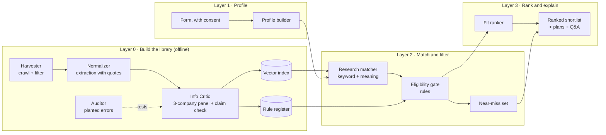

# Documentation overview

This section describes ACCESS layer by layer. Each component is documented in the same way:

- **What it does**, in one or two sentences.
- **Method**: the concept or algorithm used.
- **Why this method**: the alternatives considered, including the state of the art, and the trade-off we accepted.
- **Evidence**: a measurement showing whether it works, and where it fails.

## Objectives

ACCESS was designed around four objectives:

1. **A reliable repository.** Collect and structure funding opportunities from heterogeneous web sources, with every
   displayed fact verified.
2. **Researcher profiles.** Capture research interests, background and eligibility attributes from consent-based input.
3. **Constraint-aware filtering.** Exclude opportunities the researcher is not eligible for, while keeping "near misses"
   whose gap could realistically be closed.
4. **Fit ranking and evaluation.** Rank eligible opportunities by fit with the researcher, and compare the approach
   against a relevance-only baseline.

## Architecture

ACCESS is a **neuro-symbolic, multi-agent workflow**. Language models read, judge and write; deterministic code
searches, decides eligibility and scores. No model is trained: all models are pretrained and used through prompts or
embeddings, on free tiers or run locally.

## Three design principles

**Cascade.** Cheap operations run on everything; expensive ones run on the few items that remain. A free keyword
filter discards most web pages before any language model reads them, and model reasoning is applied only to the
candidates that survive filtering. This matters because free model quotas, not computing power, limit the system.

**Independence.** No model checks its own work. The model that extracts facts (Google Gemini) comes from a different
company than the three judges that verify them, and the auditor that tests the judges never grades its own votes.
Language-model evaluators are known to favour their own outputs [[12]](../references.md), and errors that are
independent cancel out under a majority vote, while correlated errors do not [[11]](../references.md).

**Fail closed.** A fact that cannot be confirmed is withheld and shown as "not stated, see the official page", never
guessed. An error therefore becomes a missing value rather than a wrong one.

## How the agents work together

The background agents never call each other directly. They read and write one shared database (a *blackboard
architecture*), so each agent can be stopped, restarted or scaled independently without affecting the others.

| Agent | Role |
|---|---|
| Scout | Finds websites to crawl: curated seeds, ranked universities, national agencies, links found while crawling |
| Scraper | Crawls sites, renders pages built by JavaScript, and runs the Normalizer on candidate pages |
| Critic | Verifies each record with a three-company judge panel and the claim check, then publishes verified records |
| Auditor | Tests the Critic by planting known errors and by blind re-reading of random pages |
| Sentinel | Monitors progress every five minutes and applies a whitelisted set of safe fixes, such as restarting an agent |
