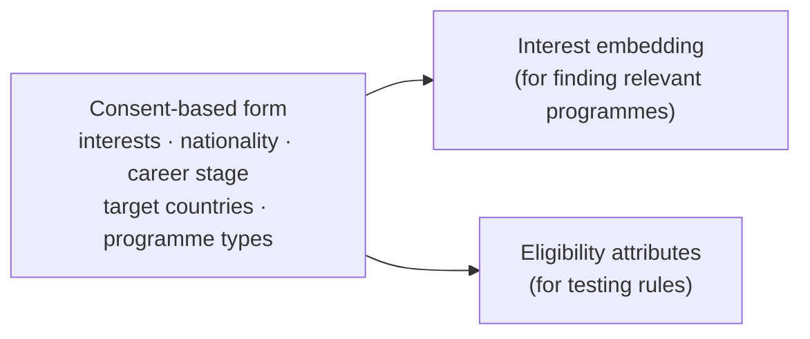

# Layer 1 · Understanding the user

Layer 1 turns a short form into a **researcher profile**. The profile mirrors the programme record: an embedding
that represents the researcher's interests, and typed attributes that can be tested against eligibility rules.

## Input form: consent and data minimisation

**What it does.** Collects only what matching needs, after explicit consent.

**Method.**

- A consent box must be ticked before a search runs.
- Saved searches never store a personal name; they are kept only to evaluate the system.
- A blank field means **unknown**, never "no" and never a default value. An early version used a default age of 25,
  which silently decided age rules for users who had never given an age; this was removed.

**Why.** Consent-based capture is part of the design, and data minimisation follows the principles of Singapore's
Personal Data Protection Act (PDPA).

## Profile builder

**What it does.** Converts the form into the two representations above.

**Method.** Facts from the form are used unchanged. Research fields are inferred locally by *zero-shot embedding
classification*: the description and 25 field labels are embedded, and every field within a small margin (0.035) of
the best cosine score is kept. The user can confirm or override the inferred fields.

**Why this method.** An earlier version used a cloud language model to build the profile, which made every search
depend on the model's quota. The local method answers instantly and never fails because a provider is busy. A margin
is used rather than the single best label because the top label alone was noisy (for one physicist, physics scored
just below chemistry).

**Evidence.** The whole first-results path, including the profile, takes 0.02–0.3 s with no cloud AI.

## One follow-up question

**What it does.** After a search, ACCESS may ask one question, such as "How many years since your PhD?".

**Method.** The question is the missing attribute that appears in the most "unknown" eligibility checks across the
results. Each unknown check is an uncertain outcome, so the attribute that occurs most often removes the most
uncertainty per question: a greedy approximation of *information gain*.

**Why.** It is deterministic, free and asks one question at a time, instead of a long questionnaire up front or a
conversational interviewer.
