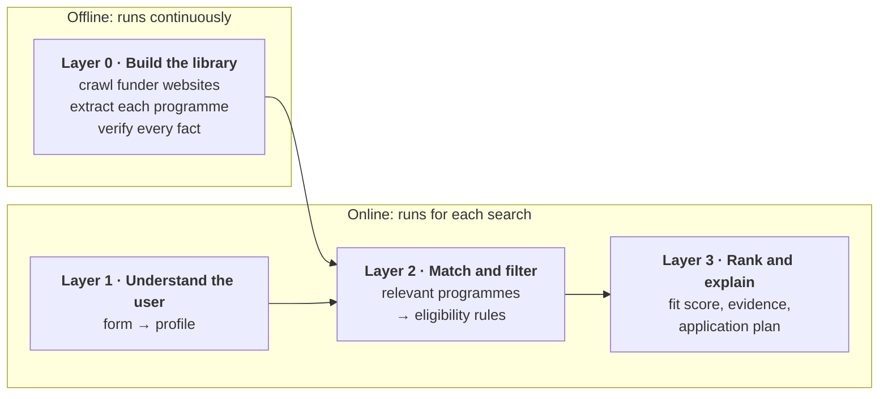

---
hide:
  - navigation
---

# ACCESS

**AI-Curated Constraint-Aware Eligibility & Scholarly Search**

*GP8000 / GP8001 AI Literacy · Cohort C · Group 5*

Researchers look for funding across thousands of university, government and foundation websites. Most of what they
find is irrelevant, and much of what looks relevant is closed to them: it requires a different nationality, career
stage or host country. Existing scholarly recommender systems rank opportunities by **topic**; they do not check
**eligibility**, and they do not verify that the facts they display are correct.

ACCESS is a multi-agent AI system that addresses both problems. It builds a library of funding programmes from the
open web, **verifies every displayed fact against the funder's own page**, and returns only the programmes a
researcher is eligible for, ranked by fit and with the evidence for each decision.

370

programmes with every displayed fact verified

631

eligibility rules, each backed by a quote from the funder's page

0.4 s

to the first eligibility-filtered results

93%

of test searches find the target programme in the top five

<small>Figures as of 12 October 2026. See [Results](results.md).</small>

## The idea in one picture

Swipe sideways to see the whole diagram.

The design rests on one division of labour: **language models read; deterministic code decides.** Models are good at
reading messy web pages and judging whether a sentence supports a claim. Code is better at decisions that must be
reproducible and explainable, such as whether a researcher meets a nationality rule.

## How to read this site

| If you want to… | Go to |
|---|---|
| Understand how each part of the system works and why it was built that way | [Documentation](documentation/index.md) |
| See what ACCESS can do today, and how we measured it | [Results](results.md) |
| Look up a technical term in plain language | [Glossary](glossary.md) (terms are also explained when you hover over them) |
| Find the literature we build on | [Literature review](documentation/literature.md) and [References](references.md) |

## Scope

ACCESS covers **research funding**: scholarships from undergraduate to PhD level, research fellowships, postdoctoral
positions, research grants and travel grants. Coverage priority goes to the destinations with the most student
traffic: Singapore, the United States, the United Kingdom, Japan, China (including Hong Kong), Australia, Canada and
the rest of Europe.

ACCESS supports discovery and decision-making only. It does not submit applications or contact funders on a user's
behalf, because doing so would transfer decision-making agency from the researcher to the system and raise questions
of safety and accountability.
